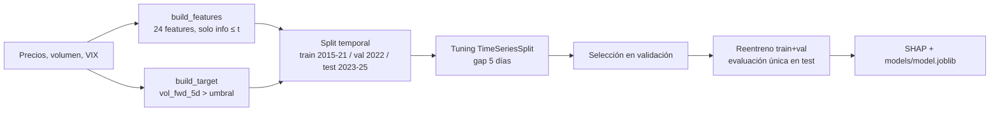
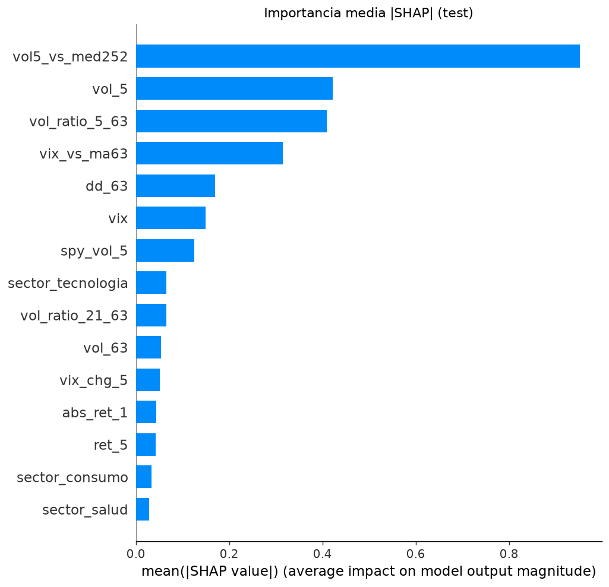
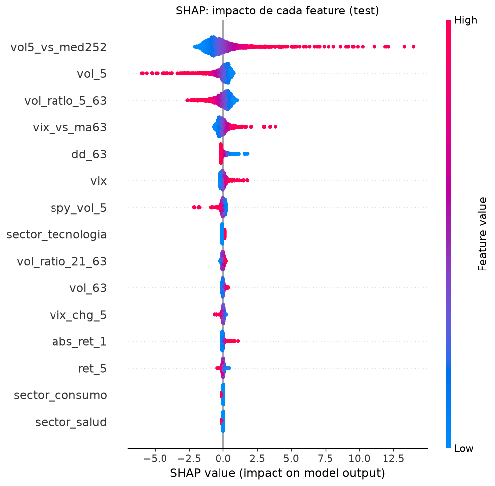

# 🌪️ Predicción de volatilidad de acciones de EE.UU. con Machine Learning

Proyecto 2 del portafolio de finanzas. Clasificador que anticipa si la **volatilidad de los próximos 5 días hábiles** de una acción será **alta**, con validación temporal estricta, comparación contra un baseline y explicabilidad con SHAP.

> **Resumen honesto:** hay señal, pero modesta. El mejor modelo logra **ROC-AUC 0,646** en test (2023-2025) frente a **0,588** de la persistencia y **0,627** de un **HAR-RV** simple (Corsi, 2009): la mayor parte de la mejora viene de mirar la volatilidad en varias escalas de tiempo, y las 24 features aportan solo **+0,019** sobre HAR-RV (IC 95 % que roza el cero). Predecir la *dirección* del precio con las mismas features da ~0,53 (casi azar).

## 🎯 Problema

Predecir hacia dónde va el precio es casi aleatorio; la volatilidad, en cambio, **se agrupa en el tiempo** (autocorrelación lag-1 de |retorno| ≈ 0,25 vs ≈ -0,06 del retorno). Dado lo que se sabe al cierre del día *t*, ¿será alta la volatilidad de *t+1..t+5*?

**Definición exacta del target** (para cada ticker):

| Elemento | Definición |
|---|---|
| `vol_fwd_5d(t)` | desv. estándar de los retornos de t+1..t+5, anualizada (× √252) |
| `umbral(t)` | mediana de los últimos 252 días de la vol 5d *trailing* (t-4..t) del ticker; solo datos ≤ t |
| `target(t)` | `1` si `vol_fwd_5d(t) > umbral(t)`, si no `0` (≈ 50 % de positivos, varía por régimen) |

## 📦 Datos

- Mismos 16 tickers y período (2015-2025) que el [proyecto 1](../01-analisis-mercado) (análisis de mercado). `src/data.py` y `data/prices.parquet` se copiaron de allí; en este proyecto se añadieron `load_volume()` y `load_vix()` (volumen diario y `^VIX`, con cache parquet).
- Fuente: Yahoo Finance vía `yfinance`, solo con fines educativos y no comerciales (ver [aviso de datos](#-datos-y-aviso-de-uso)).
- Dataset final: 40.064 filas ticker-día × 24 features (2016-01 a 2025-12).

## 🔧 Metodología



- **Features** (`src/features.py`, función pública `build_features`): vol realizada 5/21/63d y ratios, `vol5_vs_med252`, retornos 1/5/21d, |retorno|, drawdown 63d, vol del SPY, nivel/cambio/ratio del VIX, ratio de volumen, día de la semana y sector (one-hot). **Cero leakage**, verificado con tests.
- **Validación**: split temporal, *purge* de 5 días en las fronteras, `TimeSeriesSplit` por fechas con gap de 5 días para el tuning. El test se usa una sola vez; el modelo se elige en validación.
- **Baselines** (`src/baselines.py`): persistencia; logística de una sola feature (`vol5_vs_med252`); y **HAR-RV** (regresión lineal de la vol futura sobre la vol realizada diaria, semanal y mensual, OLS agrupado) con su predicción convertida en score respecto al mismo umbral.
- **Modelos completos (24 features)**: regresión logística (con escalado), Random Forest y XGBoost. Umbral de decisión fijo en 0,5.
- **Selección**: solo entre los modelos completos y solo por ROC-AUC en validación; el test nunca interviene en la elección.

## 📊 Resultados (test 2023-2025)

| Modelo | ROC-AUC | PR-AUC | F1 | Precisión | Recall | Brier |
|---|---|---|---|---|---|---|
| Persistencia (baseline) | 0,588 | 0,546 | 0,517 | 0,515 | 0,518 | - |
| Logística 1 feature (baseline) | 0,588 | 0,546 | 0,464 | 0,537 | 0,408 | 0,243 |
| HAR-RV (baseline) | 0,627 | 0,577 | 0,592 | 0,518 | 0,690 | - |
| **Regresión logística** (elegido) | **0,646** | **0,598** | 0,517 | 0,597 | 0,455 | 0,233 |
| Random Forest | 0,614 | 0,583 | 0,459 | 0,578 | 0,380 | 0,236 |
| XGBoost | 0,639 | 0,598 | 0,475 | 0,600 | 0,393 | 0,235 |

HAR-RV y la persistencia no producen probabilidades, por eso no tienen Brier. La logística de 1 feature es una transformación monótona de la persistencia: mismo ROC-AUC/PR-AUC, distinto umbral y calibración. Tablas completas (validación, ROC-AUC por sector y por año, bootstrap) en [`reports/metrics.md`](reports/metrics.md) y [`reports/metrics.json`](reports/metrics.json).

### ¿Cuánto aportan las features adicionales?

| Salto | Δ ROC-AUC (test) | IC 95 % (bootstrap por meses) |
|---|---|---|
| Persistencia → HAR-RV (vol en 3 escalas) | +0,038 | [+0,025, +0,052] |
| HAR-RV → logística con 24 features | **+0,019** | [-0,001, +0,036] |
| Persistencia → logística con 24 features (total) | +0,057 | [+0,033, +0,081] |

Honestamente: aproximadamente **dos tercios** de la ganancia sobre la persistencia se obtienen solo con la estructura HAR (vol diaria, semanal y mensual). VIX, volumen, drawdown, sector y demás añaden un tercio, y esa mejora es estadísticamente marginal (el IC roza el cero, P(Δ>0) ≈ 0,96). Para este problema, un HAR-RV simple es un competidor serio.

**Hallazgos**
- Frente a la persistencia, el mejor modelo mejora el AUC en los tres años de test y en 5 de 6 sectores (más en SPY: 0,77 vs 0,67). Frente a HAR-RV la ventaja es pequeña pero consistente por año (2023: 0,604 vs 0,573; 2024: 0,576 vs 0,552; 2025: 0,677 vs 0,640) y se concentra en Bancos (+0,066) y SPY (+0,038); en Consumo y Tecnología es casi nula.
- En **Salud** el modelo completo no mejora a ningún baseline (0,575 vs 0,584 persistencia y 0,595 HAR-RV).
- Los modelos más complejos **no** superan a la regresión logística.
- El F1 a umbral 0,5 es igual al baseline: la ventaja está en el *ranking* de probabilidades, no en la etiqueta dura. Las probabilidades están poco calibradas (Brier ≈ 0,235 vs ≈ 0,25 de predecir la tasa base).

### Explicabilidad (SHAP)

Top-5 features: **`vol5_vs_med252`, `vol_5`, `vol_ratio_5_63`, `vix_vs_ma63`, `dd_63`**.

| Importancia global | Impacto por feature |
|---|---|
|  |  |

Explicaciones locales (un acierto y un error): [`shap_waterfall_acierto.png`](reports/figures/shap_waterfall_acierto.png), [`shap_waterfall_error.png`](reports/figures/shap_waterfall_error.png). También hay curva de calibración y matrices de confusión en `reports/figures/`.

El análisis completo y narrado está en [`notebooks/modelado.ipynb`](notebooks/modelado.ipynb) (con outputs).

## ⚠️ Limitaciones

- Mejora real pero modesta (+0,06 AUC sobre persistencia, +0,019 sobre HAR-RV); probabilidades poco calibradas.
- Cambio de régimen entre validación (65 % de positivos en 2022) y test (45 %): un único corte temporal es una estimación ruidosa.
- 16 tickers grandes elegidos hoy (sesgo de supervivencia), horizonte único de 5 días, sin eventos (resultados, Fed) ni costos de transacción.
- El modelo lineal extrapola mal ante valores extremos (ver el caso de error en SHAP).
- No es una recomendación de inversión.

**Próximos pasos:** transformar/winsorizar features, añadir calendario de eventos, walk-forward con calibración, comparar con GARCH/HAR-RV.

## 🚀 Cómo reproducir

```powershell
python -m venv .venv
.venv\Scripts\activate            # Linux/macOS: source .venv/bin/activate
pip install -r requirements-dev.txt

python -m src.train               # entrena, evalúa, genera reports/ y models/ (--no-shap, --n-iter N)
pytest                            # tests (sin red)
jupyter nbconvert --to notebook --execute --inplace notebooks/modelado.ipynb
```

`data/*.parquet` se usan como cache; si faltan se descargan con `yfinance`.

## 🔌 Uso en el proyecto 3 (API)

`models/model.joblib` + `models/metadata.json` (features en orden, umbral de decisión, fecha de entrenamiento, versión, métricas de test y de los baselines) son el contrato con la API. El bloque **`required_inputs`** de `metadata.json` declara lo que la API debe recibir: las series necesarias (precios con `SPY`, VIX y volumen), el **historial mínimo en días hábiles** (`min_history_days`, calculado empíricamente; hoy 257) y la lista de **tickers soportados con su sector**.

Para inferir: `build_features(prices_hasta_t, vix, volume)`, tomar la fila de *t* y `model.predict_proba(fila[metadata["features"]])`. Un ticker fuera de la lista soportada lanza un `ValueError` claro, porque el modelo solo conoce el sector de los 16 tickers de entrenamiento.

## 🗂️ Estructura

```
02-ml-volatilidad/
├── src/
│   ├── data.py          # Descarga/cache y métricas (copiado del proyecto 1 + volumen y VIX)
│   ├── features.py      # build_features / build_target / make_dataset / min_history_days
│   ├── baselines.py     # HAR-RV y logística de 1 feature
│   ├── train.py         # Splits, tuning, evaluación, reportes (python -m src.train)
│   └── explain.py       # SHAP
├── tests/               # Anti-leakage, target, splits, baselines, artefacto del modelo
├── notebooks/modelado.ipynb
├── models/              # model.joblib, metadata.json
├── reports/             # metrics.json/.md, shap_importance.json, figures/
├── data/                # prices, volume y vix en parquet
├── pyproject.toml · requirements*.txt · .python-version
└── LICENSE
```

## 📄 Datos y aviso de uso

- Los precios, volúmenes y VIX provienen de Yahoo Finance a través de `yfinance`; este proyecto **no tiene afiliación** con Yahoo.
- Los datos (`data/*.parquet`) se incluyen **solo con fines educativos y no comerciales**; los términos de uso de Yahoo aplican a esos datos.
- La licencia MIT cubre el **código**, no los datos.
- Este análisis es descriptivo y **no constituye una recomendación de inversión**.

## ⚖️ Licencia

Código bajo licencia [MIT](LICENSE) © 2026 Elias Orellana.

## 🛠️ Stack

Python 3.12 · pandas · numpy · scikit-learn · XGBoost · SHAP · matplotlib · pytest · Jupyter

